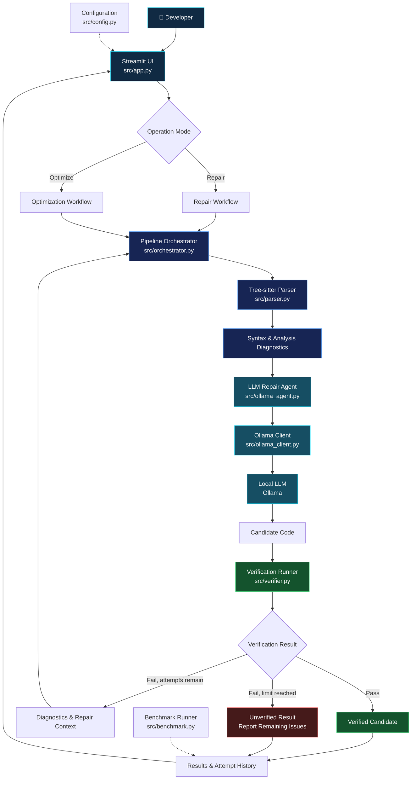

---

## 🔬 Research Focus

**Can AI-assisted code modernization be made more reliable through structural analysis and independent verification?**

*An experimental pipeline exploring the intersection of static analysis, compiler tooling, and local large language models.*

## 🧩 The Problem

Legacy code modernization is not simply a matter of generating cleaner code. Automated changes can introduce syntax errors, alter program behavior, weaken safety checks, or create new defects.

Large language models can propose useful transformations, but their output must be evaluated independently rather than trusted by default.

SafeTransit-AI explores a verification-oriented approach to this challenge.

## 🎯 Project Objective

Build a research prototype that combines:

- **AST-based analysis** to inspect source code structure.
- **Static analysis and diagnostics** to identify potential defects.
- **LLM-assisted repair** to generate candidate code changes.
- **Automated verification** to evaluate candidates before accepting their results.
- **Attempt tracking** to distinguish successful verification from failed repair attempts.

## ⚙️ Research Approach

| Stage | Engineering approach | Purpose |
|:--|:--|:--|
| 01 · Analyze | Tree-sitter and AST-based parsing | Inspect source structure and detect syntax issues |
| 02 · Diagnose | Static analysis and verification tools | Collect actionable diagnostics |
| 03 · Transform | Local LLM through Ollama | Generate a candidate repair or optimization |
| 04 · Verify | Automated checks | Evaluate the candidate against available checks |
| 05 · Report | Pipeline orchestration and result history | Expose the outcome and remaining issues |

## 📌 Current Scope

SafeTransit-AI is a **local research prototype** supporting Python and C workflows. It uses a Streamlit interface, Tree-sitter-based parsing, a local Ollama model, and automated verification tools.

The current implementation is an exploration of safer AI-assisted transformation—not a proof of semantic equivalence, complete memory safety, or production readiness.

**Current engineering checkpoint:** 86 automated tests passed; Ruff checks passed. Cloud deployment remains pending.

---

---

## 🏗️ System Architecture

SafeTransit-AI separates the user interface, source-code analysis, model interaction, pipeline orchestration, and verification into distinct modules.

> The diagram is a conceptual view of the modules and intended workflow. Before publishing it as the definitive implementation diagram, we'll confirm the exact call order and benchmark reporting path against the current source files.

### 🔎 Architecture Glossary

| Component | Role in SafeTransit-AI |
|---|---|
| <abbr title="Abstract Syntax Tree: a tree representation of source-code structure">AST</abbr> | Represents source code structurally so it can be parsed and inspected. |
| <abbr title="Static analysis examines code without relying solely on executing the program">Static Analysis</abbr> | Identifies potential issues through automated source-code checks. |
| <abbr title="Large Language Model">LLM</abbr> | Proposes candidate code transformations using the local Ollama model. |
| <abbr title="The module that coordinates parsing, repair attempts, verification and results">Orchestrator</abbr> | Controls the pipeline and tracks repair attempts. |
| <abbr title="Automated checks applied to a candidate before it is reported as verified">Verification</abbr> | Evaluates the candidate against the checks currently implemented. |
| <abbr title="A failed verification result used to guide another repair attempt">Diagnostic Feedback</abbr> | Supplies error information for subsequent attempts when permitted. |

---

## 🔄 Repair vs. Optimize

SafeTransit-AI provides two operation modes for exploring AI-assisted code transformation. Both evaluate generated candidates, but they begin with different objectives.

<table>
<thead>
<tr>
<th align="left">Dimension</th>
<th align="left">🛠️ Repair Mode</th>
<th align="left">⚡ Optimize Mode</th>
</tr>
</thead>
<tbody>
<tr>
<td><strong>Primary goal</strong></td>
<td>Address detected defects and verification failures.</td>
<td>Explore improvements to code that already passes the required initial checks.</td>
</tr>
<tr>
<td><strong>Starting point</strong></td>
<td>Source code requiring correction.</td>
<td>Source code selected for improvement.</td>
</tr>
<tr>
<td><strong>Model involvement</strong></td>
<td>Generate a candidate repair using available diagnostics.</td>
<td>Generate a candidate optimization.</td>
</tr>
<tr>
<td><strong>Verification</strong></td>
<td>Evaluate the candidate using the implemented checks.</td>
<td>Evaluate the optimized candidate using the implemented checks.</td>
</tr>
<tr>
<td><strong>Possible outcome</strong></td>
<td>Verified candidate, or a reported failure with remaining diagnostics.</td>
<td>Verified candidate, or a reported failure with remaining diagnostics.</td>
</tr>
</tbody>
</table>

> **Important:** Passing the available checks does not guarantee semantic equivalence, complete memory safety, or improved runtime performance. Optimization claims require appropriate benchmarks, and verification claims are limited to the checks actually performed.

