

---

## 🔬 Research Focus

**Can AI-assisted code modernization be made more reliable through structural analysis and independent verification?**

*An experimental pipeline exploring the intersection of static analysis, compiler tooling, and local large language models.*

## 🧩 The Problem

Legacy code modernization is not simply a matter of generating cleaner code. Automated changes can introduce syntax errors, alter program behavior, weaken safety checks, or create new defects.

Large language models can propose useful transformations, but their output must be evaluated independently rather than trusted by default.

SafeTransit-AI explores a verification-oriented approach to this challenge.

## 🎯 Project Objective

Build a research prototype that combines:

- **AST-based analysis** to inspect source code structure.
- **Static analysis and diagnostics** to identify potential defects.
- **LLM-assisted repair** to generate candidate code changes.
- **Automated verification** to evaluate candidates before accepting their results.
- **Attempt tracking** to distinguish successful verification from failed repair attempts.

## ⚙️ Research Approach

| Stage | Engineering approach | Purpose |
|:--|:--|:--|
| 01 · Analyze | Tree-sitter and AST-based parsing | Inspect source structure and detect syntax issues |
| 02 · Diagnose | Static analysis and verification tools | Collect actionable diagnostics |
| 03 · Transform | Local LLM through Ollama | Generate a candidate repair or optimization |
| 04 · Verify | Automated checks | Evaluate the candidate against available checks |
| 05 · Report | Pipeline orchestration and result history | Expose the outcome and remaining issues |

## 📌 Current Scope

SafeTransit-AI is a **local research prototype** supporting Python and C workflows. It uses a Streamlit interface, Tree-sitter-based parsing, a local Ollama model, and automated verification tools.

The current implementation is an exploration of safer AI-assisted transformation—not a proof of semantic equivalence, complete memory safety, or production readiness.

**Current engineering checkpoint:** 86 automated tests passed; Ruff checks passed. Cloud deployment remains pending.

---

---

## 🏗️ System Architecture

SafeTransit-AI separates the user interface, source-code analysis, model interaction, pipeline orchestration, and verification into distinct modules.

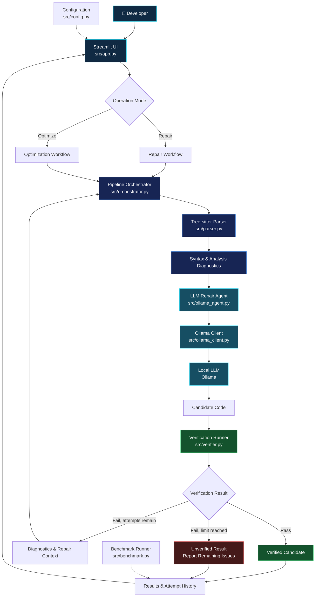

> The diagram is a conceptual view of the modules and intended workflow. Before publishing it as the definitive implementation diagram, we'll confirm the exact call order and benchmark reporting path against the current source files.

### 🔎 Architecture Glossary

| Component | Role in SafeTransit-AI |
|---|---|
| <abbr title="Abstract Syntax Tree: a tree representation of source-code structure">AST</abbr> | Represents source code structurally so it can be parsed and inspected. |
| <abbr title="Static analysis examines code without relying solely on executing the program">Static Analysis</abbr> | Identifies potential issues through automated source-code checks. |
| <abbr title="Large Language Model">LLM</abbr> | Proposes candidate code transformations using the local Ollama model. |
| <abbr title="The module that coordinates parsing, repair attempts, verification and results">Orchestrator</abbr> | Controls the pipeline and tracks repair attempts. |
| <abbr title="Automated checks applied to a candidate before it is reported as verified">Verification</abbr> | Evaluates the candidate against the checks currently implemented. |
| <abbr title="A failed verification result used to guide another repair attempt">Diagnostic Feedback</abbr> | Supplies error information for subsequent attempts when permitted. |

---

## 🔄 Repair vs. Optimize

SafeTransit-AI provides two operation modes for exploring AI-assisted code transformation. Both evaluate generated candidates, but they begin with different objectives.

<table>
<thead>
<tr>
<th align="left">Dimension</th>
<th align="left">🛠️ Repair Mode</th>
<th align="left">⚡ Optimize Mode</th>
</tr>
</thead>
<tbody>
<tr>
<td><strong>Primary goal</strong></td>
<td>Address detected defects and verification failures.</td>
<td>Explore improvements to code that already passes the required initial checks.</td>
</tr>
<tr>
<td><strong>Starting point</strong></td>
<td>Source code requiring correction.</td>
<td>Source code selected for improvement.</td>
</tr>
<tr>
<td><strong>Model involvement</strong></td>
<td>Generate a candidate repair using available diagnostics.</td>
<td>Generate a candidate optimization.</td>
</tr>
<tr>
<td><strong>Verification</strong></td>
<td>Evaluate the candidate using the implemented checks.</td>
<td>Evaluate the optimized candidate using the implemented checks.</td>
</tr>
<tr>
<td><strong>Possible outcome</strong></td>
<td>Verified candidate, or a reported failure with remaining diagnostics.</td>
<td>Verified candidate, or a reported failure with remaining diagnostics.</td>
</tr>
</tbody>
</table>

> **Important:** Passing the available checks does not guarantee semantic equivalence, complete memory safety, or improved runtime performance. Optimization claims require appropriate benchmarks, and verification claims are limited to the checks actually performed.

---

## 🖥️ Application Showcase

SafeTransit-AI provides a Streamlit interface for exploring code repair, optimization, and verification outcomes.

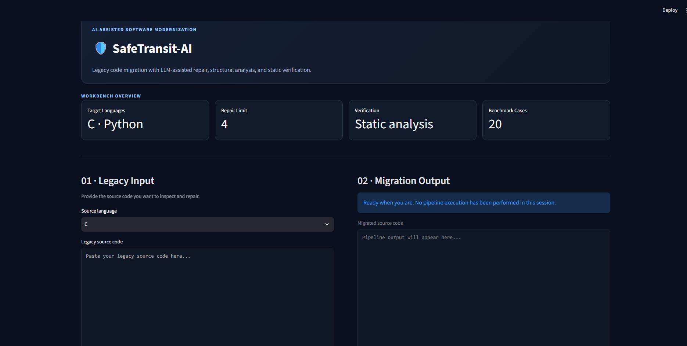

SafeTransit-AI — application interface

---

## 🔬 Inside the Pipeline

The workflow below illustrates how Repair and Optimize paths lead to verification and reporting.

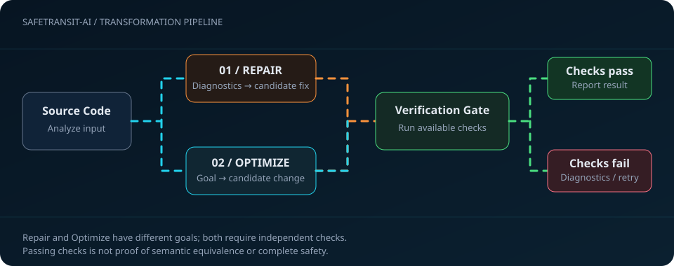

Two transformation workflows, one principle: evaluate generated code before reporting it as verified.

---

---

## 🛠️ 01 — Repair Mode

Repair Mode explores diagnostic-guided correction of source code. The pipeline evaluates the original input, generates repair candidates when appropriate, and reports the outcome of the available verification checks.

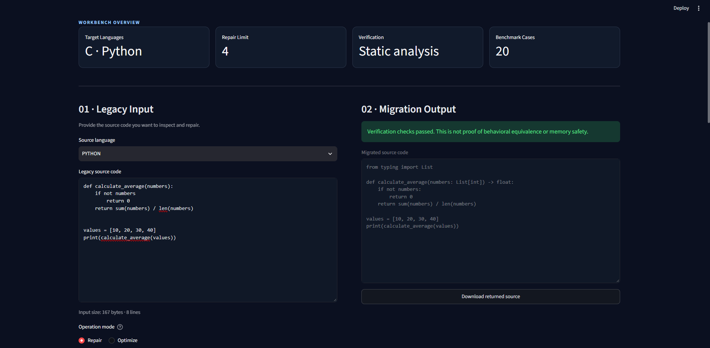

Python · Syntax repair and verification outcome

 

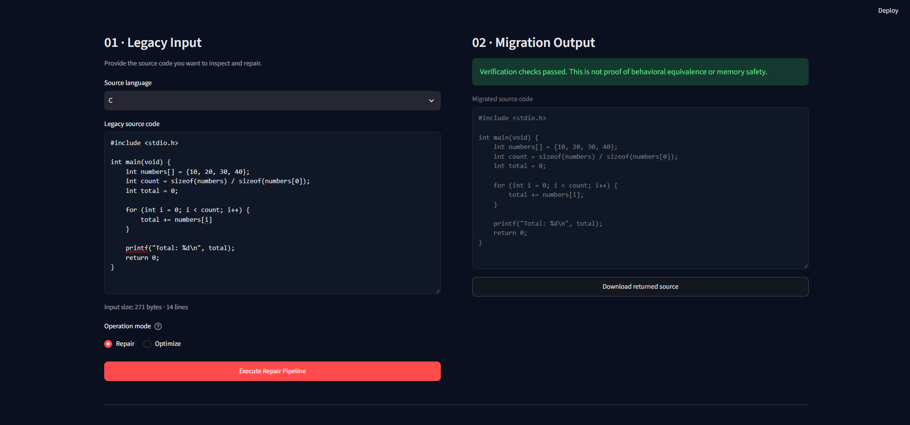

C · Syntax repair and verification outcome

📋 View repair attempt history

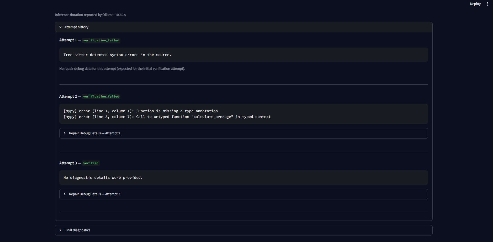

Python · Attempt history and reported diagnostics

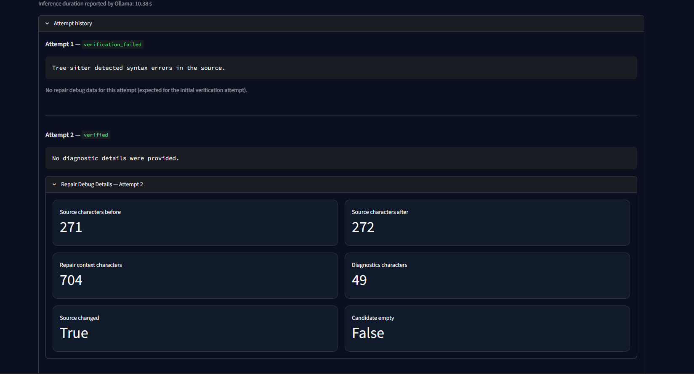

C · Attempt history and reported diagnostics

---

## ⚡ 02 — Optimize Mode

Optimize Mode explores alternative implementations of valid source code. The original input is checked before optimization, and the candidate is evaluated using the verification checks available in the current implementation.

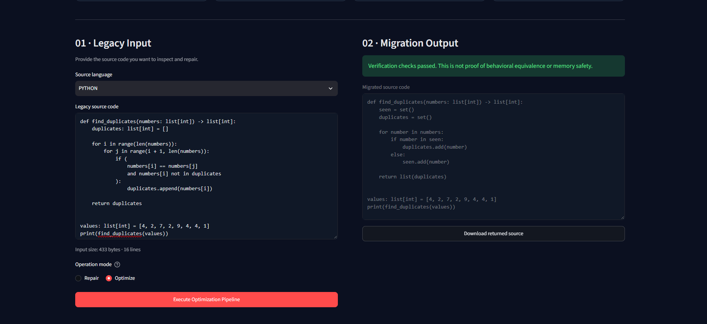

Python · Optimization candidate and verification outcome

 

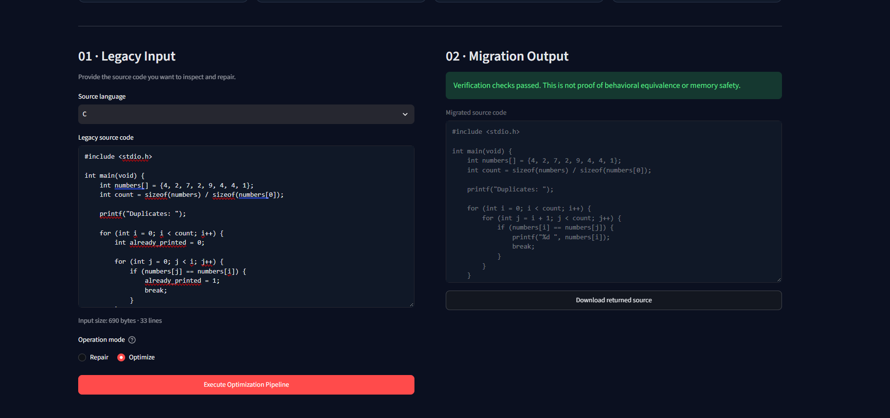

C · Optimization candidate and verification outcome

---

## 📊 Benchmark Results

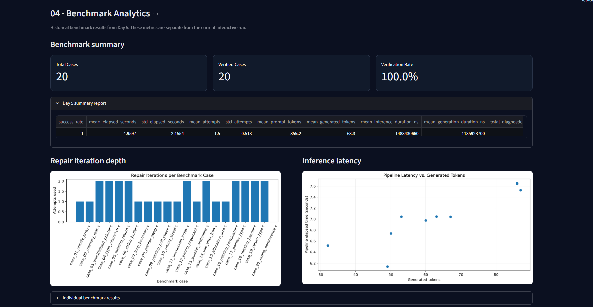

Benchmark output from the project's current implementation.

> **Verification note:** A passing result means the candidate passed the checks that were actually run. It does not, by itself, establish semantic equivalence, complete safety, or improved performance. Performance claims require suitable comparative benchmarks.

---

---

## 🧠 Model & Fine-Tuning Strategy

SafeTransit-AI explores how code-specialized large language models can support structured code repair and optimization while keeping verification outside the language model's control.

### Model Overview

| Component | Configuration |
|---|---|
| Base Model | Qwen2.5-Coder-7B-Instruct |
| Model Family | Qwen2.5-Coder |
| Fine-Tuning Approach | QLoRA |
| Quantization | 4-bit |
| LoRA Rank | 8 |
| Trainable Parameters | Approximately 5.05 million |
| Training Examples | 3 manually constructed examples |
| Optimizer Steps | 2 total |
| Training Environment | Google Colab |
| Current Inference Integration | Ollama with the base model |

### 🔬 Experimental Fine-Tuning Pipeline

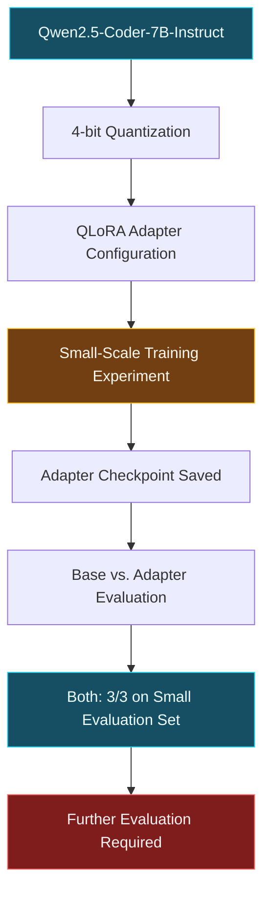

### Fine-Tuning Methodology

**1. Quantization**

The base model was loaded using 4-bit quantization to reduce memory requirements during experimentation.

**2. Parameter-Efficient Fine-Tuning**

QLoRA was used to explore adapter-based training instead of updating the full model's parameters. The LoRA rank was set to 8, with approximately 5.05 million trainable parameters reported for the experiment.

**3. Training Feasibility Test**

A small dataset of three manually constructed examples was used to verify the training pipeline. The experiment completed two optimizer steps, and an adapter checkpoint was saved.

**4. Evaluation**

The base model and the adapter-based model both achieved 3 out of 3 on the small evaluation set. This result demonstrates feasibility only; it does not establish a measurable improvement from fine-tuning or demonstrate generalization to unseen code.

### ⚠️ Current Research Status

- **Base-model integration:** Qwen2.5-Coder-7B-Instruct is integrated through Ollama.
- **QLoRA experiment:** A small-scale training run completed and produced an adapter checkpoint.
- **Performance improvement:** Not established by the current evaluation.
- **Ollama adapter integration:** The trained adapter has not yet been converted and validated for Ollama inference.
- **Production readiness:** The experimental adapter is not yet validated for production use.

### Research Direction

The next stage is to expand the training and evaluation datasets, compare the base model with the adapter on unseen repair tasks, measure verification pass rates, and validate the adapter in the intended inference environment.

The objective is not simply to generate modified code, but to investigate whether parameter-efficient adaptation can improve code transformation quality while preserving a verification-first workflow.---

## 🔬 AI Techniques & Verification

SafeTransit-AI combines language-model-assisted code transformation with structural parsing, static analysis, and verification. The model proposes changes; the surrounding pipeline evaluates whether those changes satisfy the checks implemented by the system.

### Core Techniques

| Technique | Purpose |
|---|---|
| **Abstract Syntax Tree (AST) Analysis** | Uses Tree-sitter to parse source code into structural representations for analysis. |
| **Diagnostic-Driven Repair** | Uses detected errors and diagnostics to guide repair attempts. |
| **LLM-Assisted Transformation** | Generates candidate code changes for repair or optimization. |
| **Static Analysis** | Applies available analysis tools to identify potential code issues. |
| **Compiler-Based Validation** | Uses compiler-related checks in the C workflow. |
| **Candidate Verification** | Checks generated candidates before reporting them as verified. |
| **Attempt Tracking** | Maintains repair-attempt information to support result inspection. |
| **Benchmarking** | Supports experimental comparisons of code transformation outcomes. |

### 🛡️ Verification-First Workflow

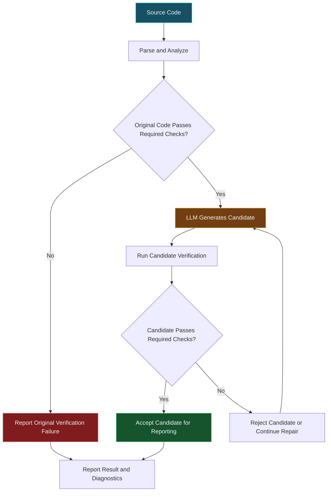

### Why Verification Matters

Language models can produce code that looks plausible but contains syntax errors, type errors, security concerns, or unintended behavioral changes. SafeTransit-AI therefore places automated checks around the transformation process instead of treating generated code as automatically correct.

The current verification pipeline provides evidence from the checks that actually run. Passing those checks does **not** prove formal semantic equivalence, eliminate every security vulnerability, or guarantee that optimized code runs faster.

### Design Principle

> **Generate with AI. Evaluate with tools. Report only what the available evidence supports.**

---

## 📈 Research Findings, Limitations & Future Work

### What We Have Established

- **A working application prototype:** Streamlit provides an interface for code repair and optimization workflows.
- **Structural code analysis:** Tree-sitter supports source-code parsing and structural inspection.
- **Verification-driven transformations:** Candidate changes are evaluated using the checks implemented in the project.
- **Local model integration:** Qwen2.5-Coder-7B-Instruct runs through Ollama in the current inference workflow.
- **Experimental fine-tuning:** A small QLoRA training run completed, providing an initial feasibility test.
- **Automated quality checks:** The project test suite and Ruff checks have been used during development.

### Current Limitations

| Area | Current Limitation |
|---|---|
| Fine-tuning | The training experiment is too small to establish generalization or improved model performance. |
| Semantic correctness | Passing automated checks does not prove that a transformation preserves program behavior. |
| Optimization | Runtime or memory improvements must be measured; they cannot be inferred from code appearance alone. |
| Verification coverage | Static analysis and compiler checks cannot detect every possible defect. |
| Language support | Current project workflows focus on Python and C. |
| Production readiness | The prototype has not been established as a production-grade, security-critical code modernization system. |

### Future Research Roadmap

**Phase 1 — Stronger Evaluation**
- Expand the repair and optimization evaluation datasets.
- Include unseen programs and more diverse failure cases.
- Compare the base model with the fine-tuned adapter using consistent evaluation conditions.

**Phase 2 — Deeper Verification**
- Investigate regression tests and differential testing.
- Explore property-based testing and stronger behavioral-equivalence checks.
- Improve verification coverage for edge cases and security-sensitive transformations.

**Phase 3 — Measurable Optimization**
- Benchmark execution time and memory usage before and after transformations.
- Repeat experiments and report measurement conditions.
- Reject optimizations that do not demonstrate a meaningful benefit.

**Phase 4 — Model and Pipeline Improvements**
- Investigate whether larger, better-curated datasets improve repair quality.
- Evaluate adapter integration in the intended inference environment.
- Track success rates, verification failures, and repair attempts across a reproducible benchmark suite.

### Research Objective

The long-term goal of SafeTransit-AI is to explore safer AI-assisted code modernization by combining language-model capabilities with structural code analysis and evidence-based verification.

The guiding principle remains simple:

> **A generated change is a candidate—not proof of correctness.**

